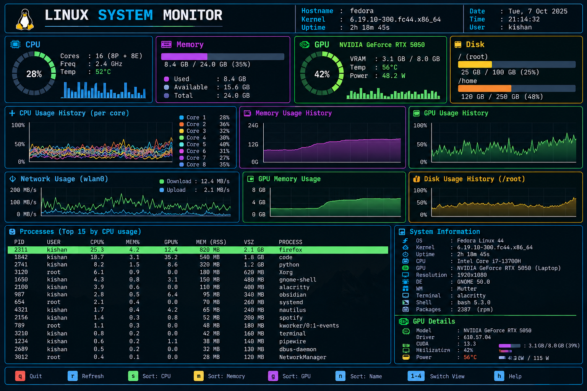
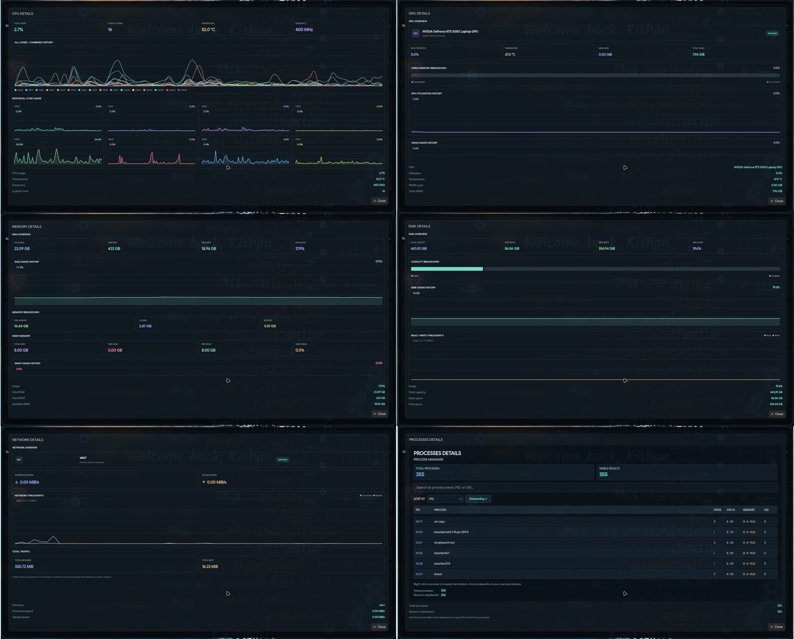

# Linux System Monitor

A modern and lightweight **Linux System Monitor** built with **C++, Qt 6, and QML**. It provides a clean, dark-themed dashboard for monitoring system resources in real time, including CPU, memory, disk, network, GPU, and running processes.

## Preview

### Main Dashboard


### Detail Information


## Features

- 🖥️ **CPU Monitoring** — Track CPU utilization, temperature, frequency, and individual core activity.
- 🧠 **Memory Monitoring** — Monitor RAM usage, available memory, cache, buffers, and swap memory.
- 💾 **Disk Monitoring** — View disk capacity, used space, free space, and read/write activity.
- 🌐 **Network Monitoring** — Monitor network interfaces, download speed, upload speed, and transferred data.
- 🎮 **GPU Monitoring** — Display GPU utilization, temperature, and VRAM usage for supported NVIDIA GPUs.
- ⚙️ **Process Manager** — Inspect running processes, CPU usage, memory consumption, process state, PID, and UID.
- 🔎 **Process Search** — Search processes by name, PID, or user ID.
- ↕️ **Process Sorting** — Sort processes by PID, name, CPU usage, memory, state, and UID.
- 🛑 **Process Termination** — Request process termination with confirmation, subject to user permissions.
- 📊 **Live Charts** — Visualize CPU, memory, and other resource activity over time.
- 🎨 **Modern Interface** — Dark theme with clear resource cards, charts, and detailed views.
- ⌨️ **Keyboard Shortcuts** — Navigate quickly between monitoring pages.
- 🐧 **Linux-Focused** — Uses Linux system information and interfaces to collect resource data.

## Technology Stack

- **Language:** C++17
- **UI:** Qt 6 Quick and QML
- **Build System:** CMake
- **System Information:** Linux `/proc`, `/sys`, and system utilities
- **GPU Monitoring:** NVIDIA `nvidia-smi` for supported hardware

## Keyboard Shortcuts

| Shortcut | Action |
|---|---|
| `Ctrl + C` | Open CPU details |
| `Ctrl + G` | Open GPU details |
| `Ctrl + M` | Open memory details |
| `Ctrl + D` | Open disk details |
| `Ctrl + N` | Open network details |
| `Ctrl + P` | Open process manager |
| `Ctrl + Q` | Quit the application |

## Project Structure

```text
linux-system-monitor/
├── CMakeLists.txt
├── include/
│   ├── cpu_monitor.h
│   ├── memory_monitor.h
│   ├── disk_monitor.h
│   ├── gpu_monitor.h
│   ├── network_monitor.h
│   └── process_monitor.h
├── src/
│   ├── main.cpp
│   ├── cpu_monitor.cpp
│   ├── memory_monitor.cpp
│   ├── disk_monitor.cpp
│   ├── gpu_monitor.cpp
│   ├── network_monitor.cpp
│   └── process_monitor.cpp
├── qml/
│   ├── Main.qml
│   ├── components/
│   │   ├── ResourceChart.qml
│   │   ├── MultiSeriesChart.qml
│   │   └── DiskActivityChart.qml
│   └── pages/
│       ├── CpuDetails.qml
│       ├── MemoryDetails.qml
│       ├── DiskDetails.qml
│       ├── NetworkDetails.qml
│       ├── GpuDetails.qml
│       └── ProcessDetails.qml
├── preview.png
├── preview2.jpg
├── README.md
├── LICENSE
└── .gitignore
```

## Requirements

Before building the application, make sure your Linux system has:

- A C++17-compatible compiler
- CMake 3.21 or newer
- Qt 6 with the Quick module
- Qt development tools and build utilities
- OpenGL support for Qt Quick rendering
- NVIDIA drivers and `nvidia-smi` for NVIDIA GPU monitoring

The GPU monitoring feature depends on compatible NVIDIA hardware and available NVIDIA utilities. Other monitoring features are designed around Linux system interfaces.

## Installation

### 1. Clone the repository

```bash
git clone https://github.com/kishan0726/linux-system-monitor.git
```

### 2. Enter the project directory

```bash
cd linux-system-monitor
```

### 3. Configure the project

```bash
cmake -S . -B build
```

### 4. Build the application

```bash
cmake --build build -j$(nproc)
```

### 5. Run the application

```bash
./build/linux-system-monitor
```

**Note:** The commands above assume that the repository is available at the specified GitHub URL and that Qt 6 development dependencies are installed. If your repository has a different URL, replace it with your actual GitHub repository URL.

## Usage

1. Launch Linux System Monitor.
2. View the system resource overview on the main dashboard.
3. Open a resource's detailed view using the available keyboard shortcuts.
4. Inspect resource activity through the live charts.
5. Open the process manager to search, sort, and inspect running processes.
6. Request process termination only when necessary and when you have the required permissions.

## Development

This project is organized into separate C++ monitor classes for each resource, with a QML-based interface.

- `src/` contains the C++ monitoring implementations.
- `include/` contains the corresponding header files.
- `qml/` contains the main interface, reusable chart components, and detailed resource pages.
- `CMakeLists.txt` defines the build configuration.

To rebuild after making changes:

```bash
cmake --build build -j$(nproc)
```

## Contributing

Contributions and improvements are welcome!

1. Fork this repository.
2. Create a new branch for your changes.
3. Make your changes and test them.
4. Commit your changes with a descriptive message.
5. Open a Pull Request explaining your improvements.

## Future Improvements

Potential future enhancements include:

- Additional process management features
- More detailed per-core and per-process statistics
- Improved chart customization
- Support for additional GPU vendors
- Packaging for easier installation on Linux distributions

## License

This project is licensed under the MIT License. See the [LICENSE](LICENSE) file for details.

---

**Made with ❤️ for Linux enthusiasts and developers.**
